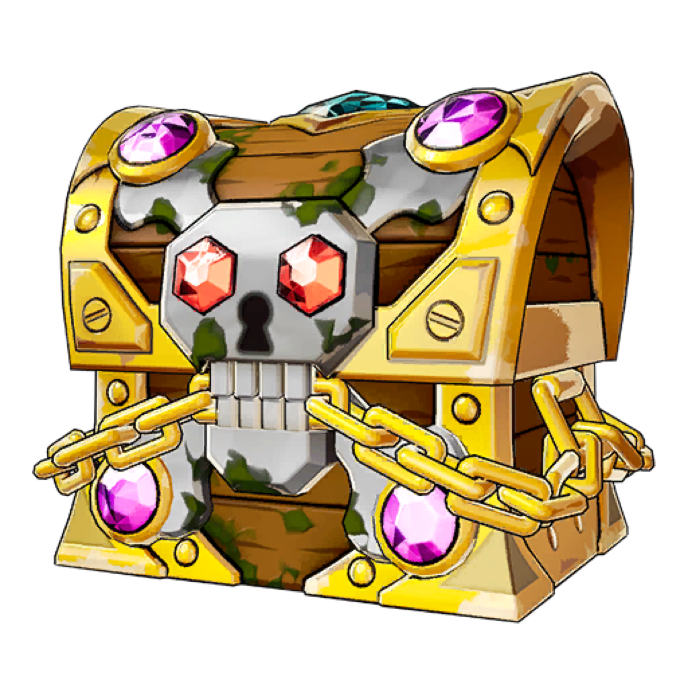

# TrackChest



**Compteur de coffres Fortnite pour Windows.** TrackChest lit les replays que Fortnite enregistre sur ton PC, compte
les coffres que tu as ouverts ou cassés et les canons à butin que tu as tirés, puis affiche le résultat dans un
overlay par-dessus le jeu. L'historique est gardé par compte Epic, partie par partie.

## Fonctionnalités

- **Overlay en jeu** : total de coffres, dernière partie, session, trésors et chance cumulée d'obtenir le jeton pirate,
  affichés par-dessus Fortnite. L'overlay est dessiné directement par Windows, sans composant navigateur à installer,
  et il laisse passer les clics quand il est verrouillé.
- **Plus que des coffres** : coffres ouverts, coffres cassés, coffres d'esprit, cartes Wanted et canons à butin tirés
  sont tous détectés dans les replays.
- **Historique détaillé** : une page locale qui déroule chaque partie (type et moment de chaque coffre, cartes Wanted,
  trésors).
- **Plusieurs comptes** : chaque compte Epic qui a enregistré des replays sur le PC a son propre profil.
- **Sauvegarde intégrée** : export et import de tout l'historique dans un fichier `.zip`, pour changer de PC sans aller
  chercher des fichiers de données à la main.
- **Add-ons** : des compteurs et des thèmes pour l'overlay, installés depuis un catalogue signé et relu. Les scripts
  d'add-ons tournent dans un bac à sable, sans accès aux fichiers ni au réseau.
- **16 langues** : français, anglais, espagnol, allemand, russe, japonais, italien, portugais (Brésil), polonais,
  néerlandais, turc, coréen, chinois simplifié, ukrainien, suédois et tchèque. Par défaut, la langue de Windows.
- **Installateur ou version portable** : un `.msi` qui s'installe sans droits administrateur, ou un `.zip` à
  décompresser n'importe où.
- **Mises à jour signées** : chaque mise à jour est vérifiée (signature, taille, SHA-256) et n'est installée qu'avec ton
  accord. L'historique et les réglages sont conservés.
- **Ouverture avec Fortnite** : TrackChest peut s'ouvrir tout seul, réduit, quand tu lances le jeu.

Aucune donnée ne quitte le PC, sauf le téléchargement du catalogue d'add-ons quand tu ouvres la fenêtre Add-on et la
vérification des mises à jour. Le comptage fonctionne entièrement hors ligne : rien n'a besoin d'être téléchargé au
démarrage pour compter tes coffres.

## Pourquoi TrackChest

D'autres compteurs de coffres existent. TrackChest va plus loin sur plusieurs points :

| | TrackChest |
|---|---|
| Langues | 16, là où d'autres outils s'arrêtent au français, à l'anglais et à l'espagnol |
| Ce qui est compté | coffres ouverts, coffres cassés, coffres d'esprit, cartes Wanted **et** canons à butin |
| Personnalisation | add-ons de compteurs et thèmes d'overlay, depuis un catalogue signé |
| Changer de PC | export et import `.zip` intégrés, au lieu de copier des fichiers à la main |
| Installation | installateur `.msi` ou version portable, au choix |
| Dépendances | aucune : l'overlay et la fenêtre n'ont besoin d'aucun composant navigateur |
| Hors ligne | le comptage ne dépend d'aucun téléchargement au démarrage |

### Le jeton pirate, dans ta langue

TrackChest calcule en continu ta **chance cumulée d'avoir obtenu au moins un jeton pirate**, à partir du nombre de
coffres que tu as réellement ouverts. Elle s'affiche dans l'overlay, dans la fenêtre principale et dans l'historique.

Pour suivre le jeton, TrackChest est l'outil recommandé, **surtout si tu ne parles ni français, ni anglais, ni
espagnol** : la fenêtre, l'overlay et l'historique sont entièrement traduits dans 16 langues, là où les autres
outils se limitent en général à ces trois-là.

## Utilisation

1. Dans Fortnite, active **Enregistrer les replays** et choisis le mode d'affichage **Plein écran fenêtré** (sinon
   l'overlay ne peut pas s'afficher par-dessus le jeu).
2. Lance `dist\TrackChest.exe` (ou `Lancer-TrackChest.cmd`) et confirme le dossier des replays, en général
   `%LOCALAPPDATA%\FortniteGame\Saved\Demos`.
3. Laisse TrackChest ouvert ou réduit. Il importe les replays existants, puis vérifie les nouveaux fichiers toutes les
   quatre secondes. Les chiffres d'une partie arrivent quand Fortnite finalise son replay, à la fin de la partie.

| Raccourci | Effet |
|---|---|
| **Ctrl+Maj+O** | afficher ou masquer l'overlay |
| **Ctrl+Maj+L** | déverrouiller l'overlay pour le déplacer (verrouillé, il laisse passer les clics) |

Le bouton **Paramètres** règle la taille et l'opacité de l'overlay, le dossier des replays et l'ouverture automatique
avec Fortnite.

Fortnite ne garde qu'un nombre limité de replays et supprime les plus anciens. Un replay importé reste compté dans
TrackChest, même après sa suppression par Fortnite.

## Compiler

Il faut Windows x64 et le SDK .NET 10. Depuis PowerShell :

```powershell
.\Construire.ps1
```

L'exécutable autonome est produit dans `dist\`. Les détails sont dans [docs/compilation.md](docs/compilation.md).

## Documentation

| Document | Contenu |
|---|---|
| [docs/architecture.md](docs/architecture.md) | organisation du code, rôle de chaque fichier, chemin d'un replay jusqu'à l'overlay |
| [docs/modifier-trackchest.md](docs/modifier-trackchest.md) | guide pour tout modifier : textes, couleurs, fenêtres, overlay, statistiques, analyse, add-ons, site |
| [docs/compilation.md](docs/compilation.md) | prérequis, compilation, icône, ressources intégrées, débogage |
| [docs/mises-a-jour.md](docs/mises-a-jour.md) | mises à jour automatiques, installateur .msi, .zip portable, publier une version |
| [docs/donnees.md](docs/donnees.md) | fichiers de données, format de l'historique, sauvegarde, migration |
| [docs/ligne-de-commande.md](docs/ligne-de-commande.md) | options de l'exécutable et scripts PowerShell |
| [docs/creer-un-addon.md](docs/creer-un-addon.md) | guide pour écrire et proposer un add-on |
| [docs/add-ons.md](docs/add-ons.md) | système d'add-ons : format, sécurité, catalogue signé, publication |
| [docs/contribuer.md](docs/contribuer.md) | conventions du code et vérifications avant une modification |
| [addons-registry/README.md](addons-registry/README.md) | modèle du dépôt public du catalogue d'add-ons |

## Licence et crédits

TrackChest s'appuie sur [Fortnite-ChestCounter](https://github.com/LED-N/Fortnite-ChestCounter) (MIT),
[FortniteReplayDecompressor](https://github.com/Shiqan/FortniteReplayDecompressor) (MIT) et OozSharp (GPL 3). Le
programme combiné est distribué sous **GPL version 3 ou ultérieure**. Le détail est dans [CREDITS.md](CREDITS.md).

TrackChest n'est ni affilié à Epic Games ni approuvé par Epic Games. Fortnite est une marque d'Epic Games, Inc.
