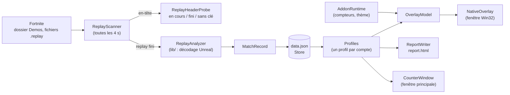

# Architecture

TrackChest est une application Windows Forms en C# (.NET 10), compilée en un seul exécutable autonome. L'overlay est
une fenêtre Win32 dessinée à la main, sur son propre thread. Le décodage des replays Unreal Engine vient de la
bibliothèque `lib/`.

## Arborescence

```text
.
├── src/ChestCounter/        code de TrackChest (projet TrackChest.csproj)
├── lib/                     décodeur de replays Unreal / Fortnite (bibliothèques tierces modifiées)
│   ├── Unreal.Core/         lecture des replays Unreal Engine
│   ├── Unreal.Encryption/   déchiffrement des replays
│   ├── FortniteReplayReader/  modèles et lecteur spécifiques à Fortnite
│   ├── OozSharp/            décompression Oodle Kraken (GPL 3)
│   └── PATCHES.md           liste des modifications faites aux bibliothèques d'origine
├── assets/                  icône, clé publique et adresse du catalogue d'add-ons
├── addons-registry/         modèle du dépôt public du catalogue d'add-ons
├── docs/                    cette documentation
├── Construire.ps1           compilation de dist\TrackChest.exe
└── dist/                    exécutable produit (non versionné)
```

Le dossier du code s'appelle encore `ChestCounter` et l'espace de noms C# est `ChestCounter` : c'est le nom du projet
d'origine. Seul le nom de l'assembly et de l'exécutable est `TrackChest`.

## Du replay à l'overlay



1. **Surveillance.** `CounterWindow` lance `ReplayScanner.Scan` toutes les quatre secondes, sur un thread de fond.
   Le scanner liste les `*.replay` du dossier configuré et ignore ceux qu'il a déjà traités. Un fichier est identifié
   par son chemin, sa taille et sa date de modification (`ProcessedFiles` dans `data.json`).
2. **Tri.** `ReplayHeaderProbe` lit seulement l'en-tête de chaque nouveau fichier. Un replay encore en cours d'écriture
   déclenche le badge « Partie en cours ». Pendant la partie, Fortnite laisse la clé de chiffrement à zéro : les
   données ne peuvent être lues qu'une fois le fichier finalisé.
3. **Analyse.** `ReplayAnalyzer` (sous-classe du lecteur de `lib/`) décode le replay complet. Il relève :
   - les coffres et conteneurs fouillés, avec le joueur qui les a fouillés, et les coffres cassés ;
   - les tirs de canons à butin ;
   - les cartes Wanted ramassées après une affiche ;
   - les trésors obtenus et leur source.

   Il identifie ensuite le joueur suivi (celui qui a enregistré le replay) et ne garde que ses actions.
4. **Enregistrement.** Le résultat est un `MatchRecord`, ajouté à `TrackerData` et écrit dans `data.json`. Une même
   partie (même `SessionId` et même compte) n'est jamais comptée deux fois.
5. **Affichage.** `Profiles.View` filtre les parties du compte choisi. `OverlayModel` construit les lignes de l'overlay
   et `NativeOverlay` les dessine. `ReportWriter` régénère `report.html` (bouton Historique).

Quand la méthode d'analyse change, `ReplayAnalyzer.CurrentVersion` est augmenté. Au lancement suivant,
`Program.cs` vide `ProcessedFiles` et les replays encore présents sont réanalysés. Les parties dont le replay a disparu
gardent leur ancienne analyse.

## Rôle de chaque fichier

Tous les fichiers sont dans `src/ChestCounter/`.

### Démarrage

| Fichier | Rôle |
|---|---|
| `Program.cs` | Point d'entrée. Lit les options, garantit une seule instance par dossier de données (mutex), charge la configuration, l'historique et les add-ons, puis lance le mode demandé : fenêtre, `--once`, aperçu de l'overlay ou veille Fortnite. |
| `NativeConsole.cs` | L'exe est une application Windows sans console. Ce fichier attache ou crée une console pour les options en ligne de commande. |
| `FortniteStartup.cs` | Ouverture automatique avec Fortnite : crée ou retire le raccourci de démarrage de Windows, et le processus de veille qui lance TrackChest quand `FortniteClient-Win64-Shipping` démarre. |

### Replays

| Fichier | Rôle |
|---|---|
| `ReplayScanner.cs` | Parcours du dossier, tri des fichiers (lu, incomplet, erreur, autre mode), appel de l'analyseur, fusion dans l'historique, journal `errors.log`. |
| `ReplayHeaderProbe.cs` | Lecture rapide de l'en-tête : replay en cours, fini, sans clé ou invalide. |
| `ReplayAnalyzer.cs` | Décodage complet d'un replay et extraction des coffres, canons, cartes Wanted et trésors. Contient aussi `ChestKinds` (classement des conteneurs par type) et `TreasureNames` (noms des trésors). |

### Données

| Fichier | Rôle |
|---|---|
| `Models.cs` | Modèles (`MatchRecord`, `ChestRecord`, `TreasureFind`, `Config`, `TrackerData`) et `Store`, qui lit et écrit les fichiers JSON de façon atomique (fichier temporaire puis remplacement). |
| `Backup.cs` | Export et import de l'historique dans un `.zip` (bouton Exporter / Importer). |
| `Profiles.cs` | Regroupement des parties par compte Epic (identifiant Epic, sinon nom du joueur). |

### Affichage

| Fichier | Rôle |
|---|---|
| `CounterWindow.cs` | Logique de la fenêtre principale : minuterie de scan, boutons, sauvegarde, rafraîchissement de l'overlay. |
| `CounterWindow.Layout.cs` | Mise en page et contrôles dessinés à la main : cartes arrondies, boutons, fond, barre de titre sombre. |
| `CounterWindow.Settings.cs` | Fenêtre Paramètres. |
| `CounterWindow.Addons.cs` | Fenêtre Add-on : installés, catalogue, installation depuis un fichier. |
| `OverlayModel.cs` | Contenu de l'overlay (lignes, valeurs, badge) à partir de l'historique, plus les tailles et opacités proposées. |
| `NativeOverlay.cs` | Fenêtre de l'overlay en Win32 pur : toujours au premier plan, transparente aux clics quand elle est verrouillée, raccourcis globaux, dessin GDI, thème de couleurs, capture PNG pour `--overlay-preview`. |
| `ReportWriter.cs` | Génération de `report.html` et règle de la session (voir plus bas). |
| `Png.cs` | Écriture minimale d'un PNG, pour les captures de l'overlay. |
| `Lang.cs` | Textes de l'interface. Ils s'écrivent `L.T("français", "English", "español")` ; l'interface est en français, aucun choix de langue n'est proposé pour l'instant. |
| `PirateTokenOdds.cs` | Chance cumulée d'obtenir le jeton pirate. |

### Add-ons

| Fichier | Rôle |
|---|---|
| `Addons.cs` | Format d'un add-on (`AddonManifest`), règles de validation (`AddonRules`) et lecture d'un paquet `.zip` (`AddonPackage`). |
| `AddonStore.cs` | Vérification de signature (`AddonTrust`), téléchargement du catalogue (`AddonCatalog`), add-ons installés (`AddonStore`) et application à l'overlay (`AddonRuntime`). |
| `AddonTools.cs` | Options `--addon-keygen`, `--addon-sign`, `--addon-verify` et `--addon-check`. |

Le fonctionnement complet est décrit dans [add-ons.md](add-ons.md).

## Règles de calcul

| Valeur | Définition |
|---|---|
| **Total de coffres** | coffres ouverts + coffres cassés + tirs de canons à butin (`MatchRecord.ChestsTotal`). Les coffres d'esprit sont inclus. Seules les parties Battle Royale sont comptées. |
| **Session** | les parties terminées après le lancement de TrackChest (`ReportWriter.IsThisSession`). Les anciens replays importés au démarrage n'en font pas partie. |
| **Dernière partie** | la partie dont le début est le plus récent. |
| **Jeton pirate** | `1 − (1 − 1/137 500)^n`, où `n` est le nombre de coffres **ouverts** (sans les coffres cassés ni les canons). Le taux de 1 sur 137 500 est une hypothèse, les tirages sont supposés indépendants. |
| **Trésors** | trésors de la chasse au trésor obtenus par le joueur suivi. Les trésors partagés par un coéquipier ne sont pas comptés. |

## Threads

- **Thread de l'interface** : fenêtres Windows Forms, minuteries, fenêtres de dialogue.
- **Thread de fond** : `ReplayScanner.Scan`, lancé par `Task.Run`. Pendant un scan, les boutons qui modifient
  l'historique (Parcourir, Actualiser, Exporter, Importer, choix du compte) sont désactivés.
- **Thread de l'overlay** : `NativeOverlay` possède sa propre boucle de messages Win32. Les autres threads lui envoient
  des messages (`PostMessage`) et publient la vue à afficher dans un champ `volatile`.

## Bibliothèques de `lib/`

Ce sont des copies modifiées de bibliothèques open source. Chaque modification est listée dans
[lib/PATCHES.md](../lib/PATCHES.md) : lecture des replays en cours d'écriture, fouille d'un coffre attribuée à un
joueur, conteneurs inconnus rattachés à un type connu, correction d'une boucle infinie, etc. Quand une bibliothèque
change, ajoute une entrée dans ce fichier.
